<div align="center">


# FileFlow

**Your Data, Under Control.**
让文件转换和数据整理变得简单。

[](https://github.com/iiiiiiiiiiiiiKK/fileflow/actions/workflows/ci.yml)
[](https://github.com/iiiiiiiiiiiiiKK/fileflow/actions/workflows/deploy.yml)
[](LICENSE)
[](#-testing)
[](#-tech-stack)

**[🚀 Live demo](https://iiiiiiiiiiiiiKK.github.io/fileflow/)** · **[Features](#-features)** · **[Quick start](#-quick-start)** · **[中文说明](#中文说明)**

Made by [KK (@0xkillcoin)](https://x.com/0xkillcoin)

</div>

---

## What is FileFlow?

FileFlow is a **free, privacy-first file and data workspace that runs entirely in your browser**.

Drop in a CSV, JSON, JSONL/NDJSON or TXT file, inspect it in a preview built for that
format, convert it to another format, filter and clean the data, then export the result as
a single file or a ZIP of several. There is no account, no upload, no server, no database
and no analytics — the file you open never leaves your machine.

> Most online converters upload your file to somebody's server. FileFlow cannot do that:
> the entire product is a static bundle, and every byte is parsed in your own tab.

### Who it is for

- Office users who need "CSV → JSON" without installing anything.
- Developers who want a quick, trustworthy look inside an exported file.
- Analysts who need to deduplicate, trim or reorder fields before importing somewhere else.
- Anyone handling personal data who would rather not hand it to a random website.

---

## ✨ Features

### Import

| Capability | Detail |
| --- | --- |
| Formats | CSV / TSV / TXT / JSON / JSONL / NDJSON |
| Input | Drag & drop, file picker, multiple files at once |
| Encoding | UTF-8, UTF-8 with BOM, UTF-16 LE/BE, GB18030 fallback — always reported in the UI |
| Detection | Delimiter (`,` `;` tab `|`), header row, JSON vs JSONL vs CSV by content when the extension is unclear |
| Guardrails | Per-file limit 25 MB, clear error for unsupported/binary files, per-file parse errors with the offending line |
| Progress | Import progress per file, non-blocking parsing (large files are parsed in a Web Worker) |

### Preview

- **CSV** — typed table with sticky header, column resizing, sorting, search, row selection and pagination (100 rows per page, so 100k+ rows stay smooth).
- **JSON** — collapsible tree with JSONPath-style labels, copy-per-node, copy-all and a formatted text view.
- **JSONL** — record-by-record parsing with valid/invalid counters and the exact line numbers that failed.
- **TXT** — plain text with search highlighting and copy; never mistaken for JSON.

### Convert

`CSV ⇄ JSON`, `CSV ⇄ JSONL`, `JSON ⇄ JSONL`, `TXT → JSON` (only when the text really is JSON).

Every conversion shows a live preview before you download, and every option below is real:

- choose the columns to include, rename the output file (extension enforced)
- CSV: delimiter, header on/off, quote-all, CRLF, `NULL` for empty values
- JSON: indent 2 / 4 / none
- UTF-8 BOM for text output
- explicit warnings when a structure cannot survive the trip (e.g. nested JSON → CSV is written as JSON text, never silently dropped)

### Filter & tidy

- Search across all columns, or restrict the search to a single column
- Sort ascending/descending (blanks always last), clear the sort at any time
- Hide, delete, rename and reorder fields
- Delete blank rows, delete empty columns, remove duplicate rows (full row or a subset of fields)
- Bulk replace: plain text or regular expression, whole-cell or substring, case-sensitive or not — with a live count of affected cells
- Select rows and delete them in one action
- **Everything is previewed before it is applied, undoable afterwards, and the imported original is always one click away**

### Clean

- Trim whitespace (including full-width spaces) without touching content
- Normalise blank values (`NULL`, `N/A`, `-`, …) into real `null`s — you choose the tokens
- Standardise date formats — the **source** format must be chosen explicitly, so `03/05/2024` is never guessed
- Missing-value and suspicious-format reports (report only, data untouched)

### Fields & statistics

- Inferred type per field (number / text / boolean / mixed / empty) — a hint, never a mutation
- Empty count, null count, distinct values, sample values
- Row count, column count, empty cells, duplicate rows
- Per-column min / max / average (numbers only), text length stats, top-5 value distribution
- Anything that cannot be computed is shown as `—`; no invented numbers

### Export

- CSV / JSON / JSONL / TXT, custom file name and extension
- UTF-8 or UTF-8 with BOM
- Single-file download, or one ZIP with every imported file
- Name collisions are resolved automatically (`out.json`, `out-2.json`, …)
- What you see is what you export: the current search and sorting are applied, and the panel tells you how many rows that is

---

## Screenshots

| Table workspace | Convert with preview |
| --- | --- |
| 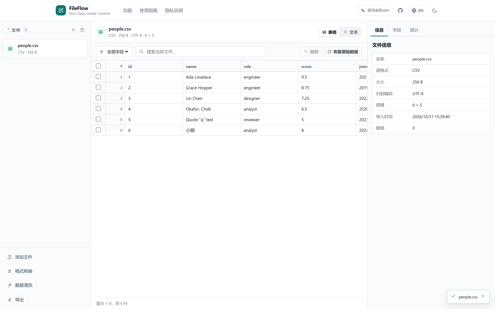 | 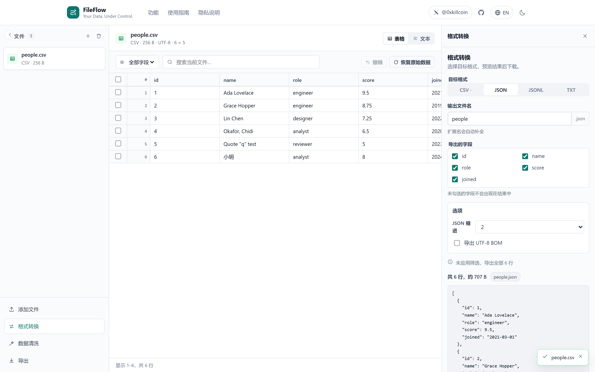 |

| Clean + bulk replace | JSON tree |
| --- | --- |
| 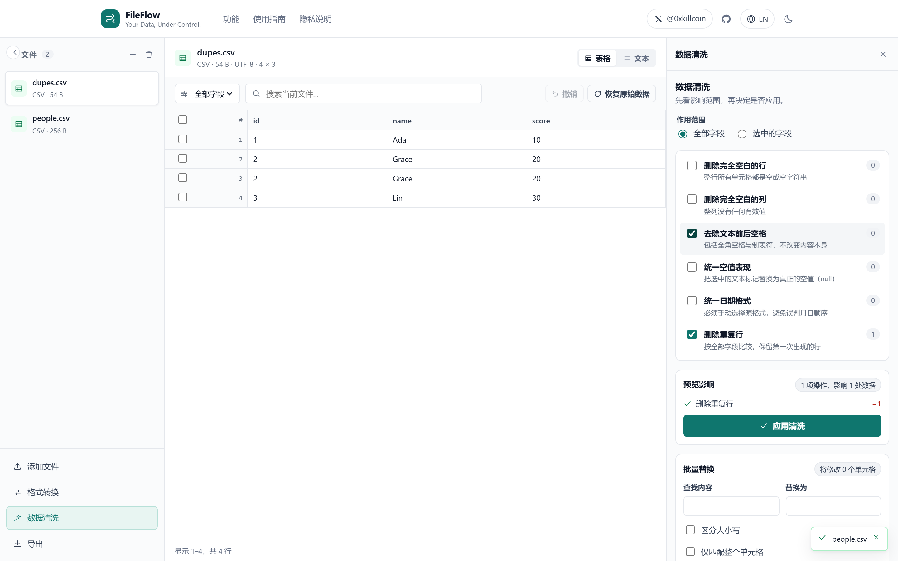 | 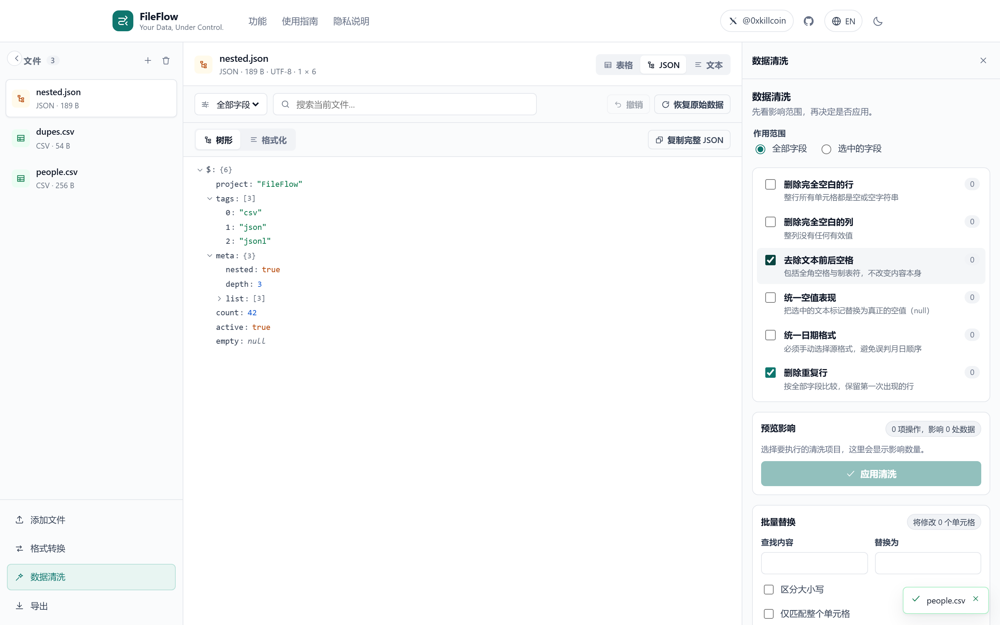 |

| Fields | Statistics |
| --- | --- |
| 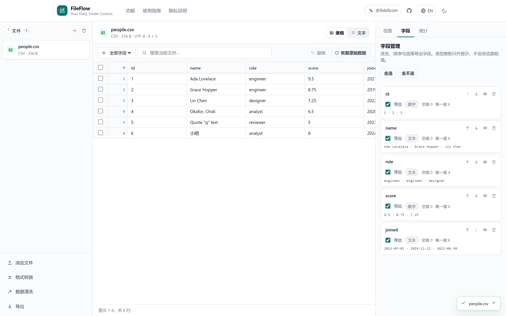 | 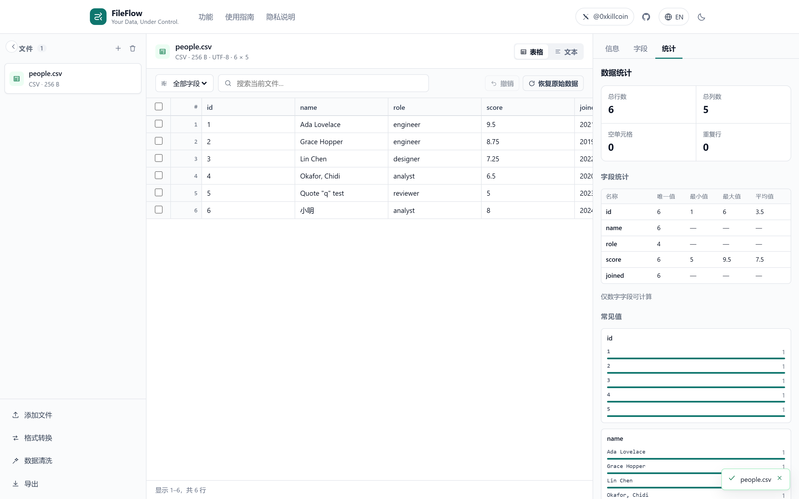 |

| Dark theme | English UI |
| --- | --- |
| 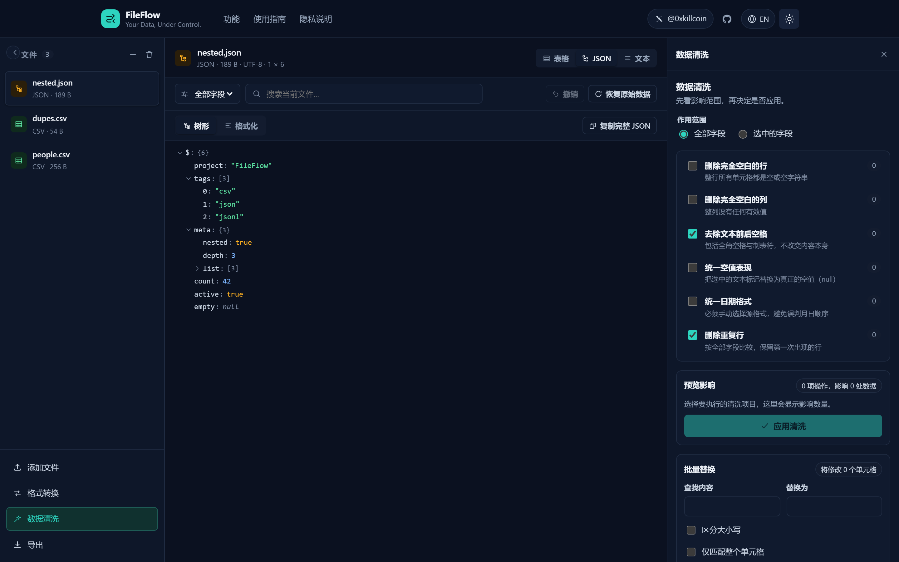 | 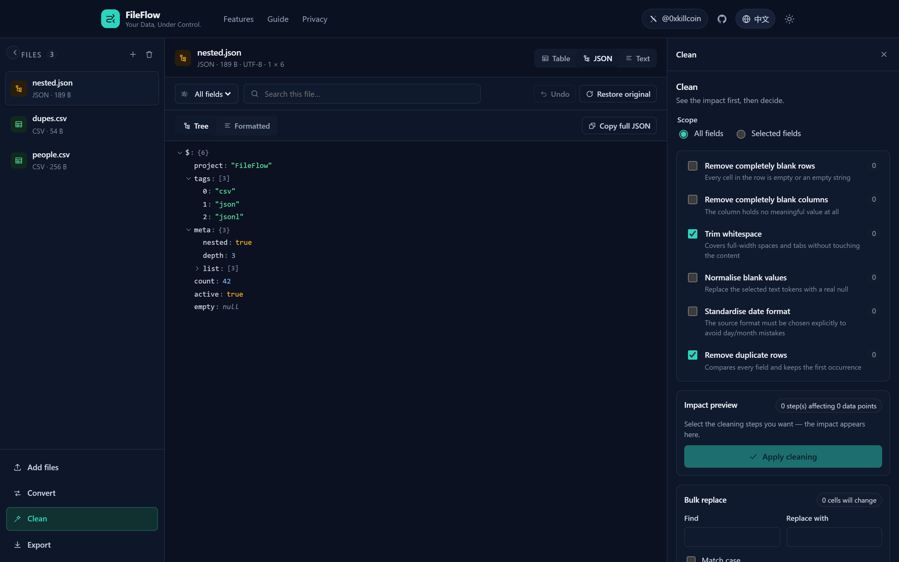 |

| iPhone — landing | iPhone — table |
| --- | --- |
| 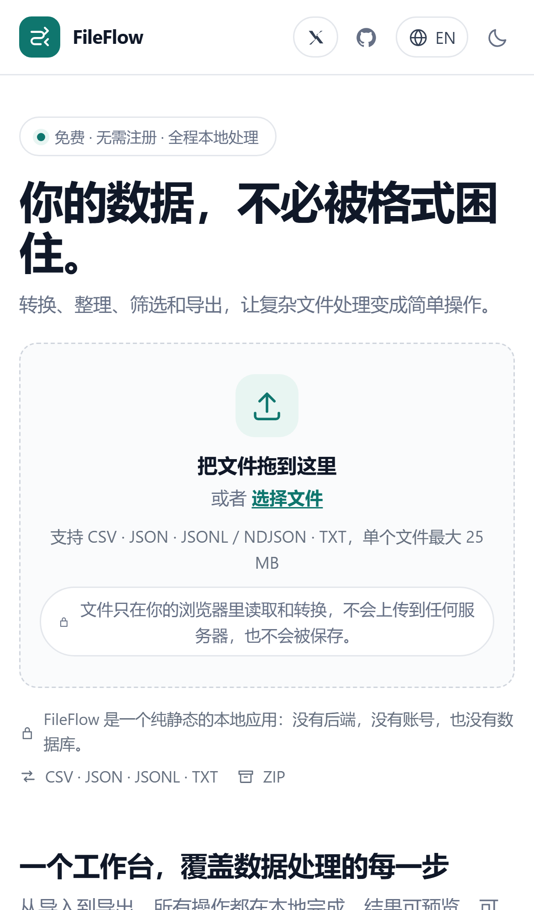 | 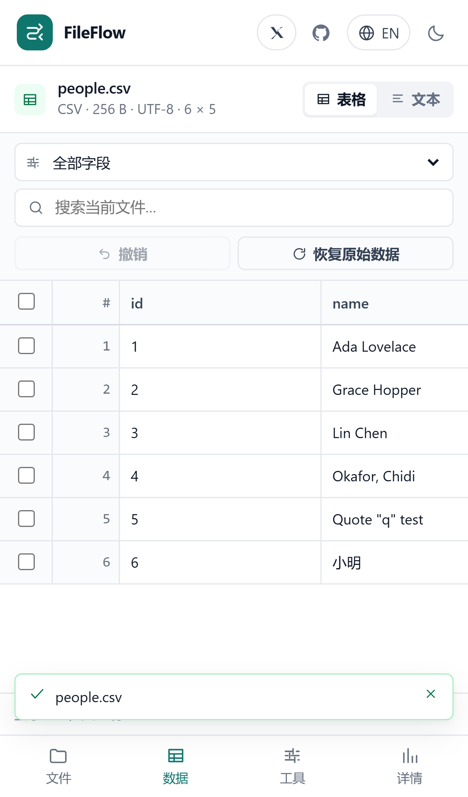 |

| iPhone — convert | iPhone — statistics |
| --- | --- |
| 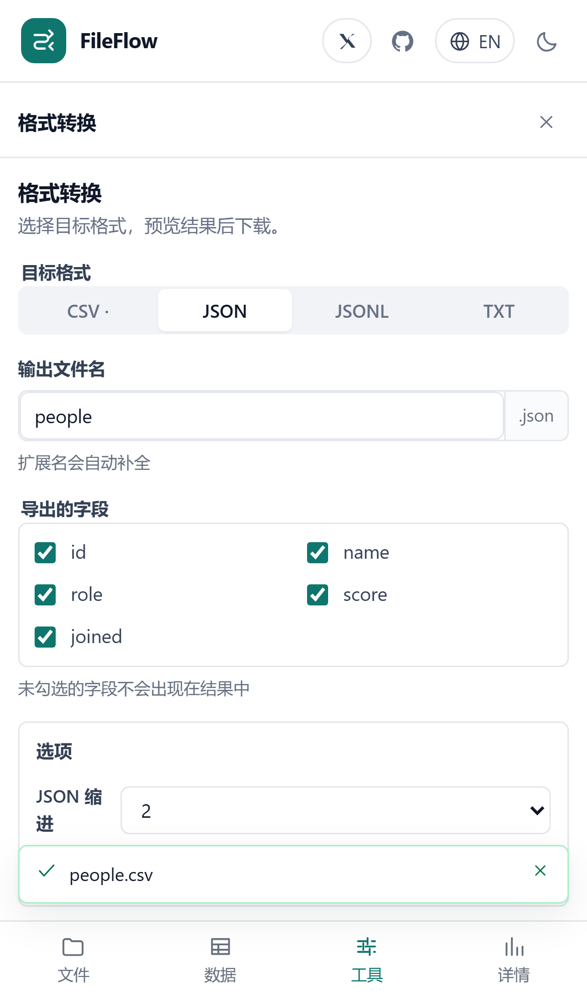 | 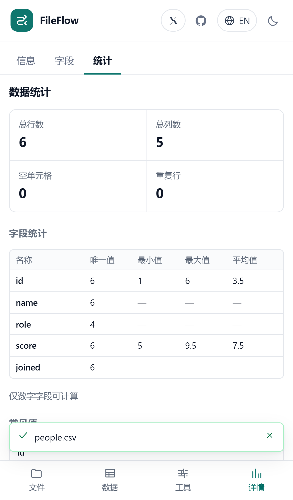 |

<sub>All screenshots are captured from the production build by `npm run screenshots` — no mockups.</sub>

---

## 🧱 Tech stack

| Layer | Choice | Why |
| --- | --- | --- |
| UI | React 18 + TypeScript (strict) | Boring, fast, easy to maintain |
| Build | Vite 6 | Instant dev server, tiny static output, no server runtime |
| Styling | Hand-written CSS with design tokens | No utility-class noise, precise control over a dense data UI, ~7.7 kB gzipped |
| CSV | [Papa Parse](https://www.papaparse.com/) (MIT) | Battle-tested RFC 4180 handling, streaming-friendly |
| ZIP | [JSZip](https://stuk.github.io/jszip/) (MIT), lazy-loaded | Only downloaded when you export a ZIP |
| Unit tests | Vitest + Testing Library | Same transform pipeline as the app |
| E2E | Playwright (Chromium, desktop + iPhone 13 + iPhone SE + responsive matrix) | Tests the real production bundle |
| Deploy | GitHub Pages (static) | Free, no cold starts, no backend to maintain |

**Why not Tailwind / TanStack Table?** Tailwind adds a build-time dependency for a UI that is
mostly one dense table; a token-based stylesheet keeps the bundle small and the table CSS
readable. The table is a windowed, paginated `<table>` of ~180 lines — TanStack Table would
have added a dependency for a feature set this app does not need. Both decisions are
reversible, they are not architectural.

---

## 🚀 Quick start

```bash
# Node.js 20+ (developed on Node 24)
git clone https://github.com/iiiiiiiiiiiiiKK/fileflow.git
cd fileflow
npm install

npm run dev        # http://localhost:5173
npm run build      # production bundle in dist/
npm run preview    # serve dist/ on http://localhost:4173
```

### Scripts

| Command | What it does |
| --- | --- |
| `npm run dev` | Vite dev server |
| `npm run build` | Type-check (`tsc -b`) then build to `dist/` |
| `npm run preview` | Serve the production build |
| `npm run typecheck` | TypeScript only |
| `npm run lint` | ESLint with `--max-warnings 0` |
| `npm run test` | Vitest unit + component tests |
| `npm run test:coverage` | Coverage report for `src/lib` |
| `npm run e2e` | Playwright (builds nothing itself — run `npm run build` first or let the config start `preview`) |
| `npm run e2e:install` | Install the Chromium binary Playwright needs |
| `npm run screenshots` | Re-capture `docs/*.png` from a running preview |
| `npm run verify:live` | Smoke-test a deployed URL |
| `npm run check` | lint + typecheck + test + build |

### Environment variables

**None.** FileFlow has no backend, no secrets and no runtime configuration. Nothing is read
from `process.env` and no `.env` file is required.

---

## 🏗 Architecture

```
src/
├── App.tsx                 # routing (home / workspace), import orchestration, shortcuts
├── components/
│   ├── Home.tsx            # landing page: hero, features, guide, privacy, FAQ
│   ├── Header.tsx          # brand, nav, author X link, language + theme toggles
│   ├── Workspace.tsx       # three-pane layout, mobile tab shell, view state wiring
│   ├── DataTable.tsx       # paginated table: sort, resize, select, sticky header
│   ├── JsonView.tsx        # collapsible tree + formatted code view
│   ├── TextView.tsx        # text view with search highlighting
│   ├── ConvertPanel.tsx    # conversion options + live result preview + download
│   ├── CleanPanel.tsx      # cleaning pipeline with impact preview + bulk replace
│   ├── ExportPanel.tsx     # single-file and ZIP export
│   ├── FieldsPanel.tsx     # rename / reorder / hide / include fields
│   ├── StatsPanel.tsx      # honest dataset statistics
│   └── InfoPanel.tsx       # file metadata, warnings, issues
├── hooks/
│   ├── useWorkspace.ts     # files + per-file sessions, undo history, view state
│   ├── useTheme.ts         # light/dark, persisted locally
│   ├── useMediaQuery.ts    # responsive switch (desktop rail ⇄ mobile tabs)
│   └── useToasts.ts        # accessible status messages
├── i18n/
│   ├── messages.ts         # complete zh-CN + en catalogue (typed against each other)
│   └── index.tsx           # provider, `t()`, browser-language detection
├── lib/                    # all logic is pure and unit-tested
│   ├── types.ts            # Dataset / Column / ViewState / Conversion contracts
│   ├── infer.ts            # conservative type inference (the "don't destroy data" rules)
│   ├── parse.ts            # decoding, format sniffing, CSV / JSON / JSONL parsing
│   ├── importer.ts         # one synchronous import pipeline (main thread or Worker)
│   ├── importClient.ts     # Worker client with a main-thread fallback
│   ├── table.ts            # filtering, sorting, dedupe, replace, dates, column ops
│   ├── stats.ts            # statistics + field summaries
│   ├── serialize.ts        # dataset → CSV / JSON / JSONL / TXT
│   ├── convert.ts          # conversion matrix, warnings, file naming
│   ├── export.ts           # download, ZIP, clipboard, unique names
│   └── limits.ts           # every hard limit in one place
└── workers/import.worker.ts# large-file parsing off the main thread
```

### Data model

```
Dataset   = { columns: Column[], rows: CellValue[][] }
CellValue = string | number | boolean | null | JsonValue[] | { [key]: JsonValue }
```

Nested JSON objects survive as structured cells instead of being stringified on import, so
`JSON → CSV → JSON` only loses structure when you explicitly export to a table format — and
the conversion panel warns you before that happens.

### Type-safety rules (why your data does not change behind your back)

| Input | Kept as | Reason |
| --- | --- | --- |
| `00123` | text | postal codes, account numbers |
| `13800138000` | number (11 digits, safe) | still fits exactly in a double |
| `110101199003071234` | text | 18 digits would lose precision |
| `` (empty) | empty string | never silently `null` or `0` |
| `null`, `NULL`, `NaN` | text | the user decides what they mean (Cleaning can convert them on request) |
| `true` / `false` | boolean | unambiguous, and only these two |
| `1,234` / `12 px` | text | locale and unit dependent |

Type inference can be switched off per conversion (`inferTypes`), and the cleaning panel never
rewrites values unless you pick the operation.

### Performance & limits

| Limit | Value | Rationale |
| --- | --- | --- |
| File size | 25 MB | keeps a single tab reliable |
| Rows / columns | 200,000 / 512 | memory bound, surfaced as a warning |
| JSON depth | 64 | measured iteratively before `JSON.parse` to avoid stack blow-ups |
| Table page | 100 rows | pagination keeps DOM size constant |
| Undo depth | 30 snapshots per file | bounded memory |
| ZIP payload | 120 MB | assembled in memory by JSZip |

Files ≥ 1 MB are parsed inside a Web Worker; if a Worker cannot start (old browser, strict
CSP) the same pure function runs on the main thread, so behaviour never diverges.

### Security & privacy

- No network requests after the page loads: no API, no analytics, no fonts, no CDN.
- No `dangerouslySetInnerHTML` anywhere; all user content is rendered as text nodes.
- File names are sanitised before they become download names (`/ \ : * ? " < > |` → `-`).
- Only `locale` and `theme` are stored in `localStorage` — never file content.
- Reloading or closing the tab discards every imported file and intermediate result.
- JSON nesting is depth-limited, ZIP payloads are size-limited, and unsupported/binary files
  are rejected with an explanation instead of being parsed as garbage.

---

## 🧪 Testing

```bash
npm run test     # 120 unit + component tests
npm run e2e      # 48 end-to-end tests (4 browser projects)
```

**Unit / component (`Vitest`, `src/**/*.test.ts(x)`)** — 120 tests across 8 files:

| Suite | Covers |
| --- | --- |
| `lib/infer.test.ts` | number/boolean sniffing, leading zeros, 15/16-digit boundary, empty cells, structured cells |
| `lib/parse.test.ts` | BOM stripping, UTF-16, GB18030 fallback, unsupported encoding, delimiter detection, format sniffing, quoted commas/newlines, header dedupe, JSON depth guard, JSONL error lines, JSON→table shapes |
| `lib/table.test.ts` | blank rows, duplicates (full/subset/unknown subset), column ops, natural sort, blanks-last, view pipeline, column filter, bulk replace (case/regex/whole-cell), trim, null normalisation, date parsing/conversion/suggestion |
| `lib/stats.test.ts` | nulls vs empties, numeric min/max/average, distinct + top values, length stats, empty datasets, field summaries |
| `lib/convert.test.ts` | CSV/JSON/JSONL/TXT serialisation, quoting, CRLF, BOM, type preservation, nested-value warnings, naming/sanitising/collisions |
| `lib/importer.test.ts` | CSV/JSON/JSONL/TXT imports, sniffing, warnings, empty file, oversize file, JSON syntax errors |
| `i18n/i18n.test.tsx` | zh/en key parity, no empty strings, interpolation, fallback, persistence |
| `components/DataTable.test.tsx` | header render, pagination, sort requests, row selection, empty state, null vs empty cells |

**End-to-end (`Playwright`, 48 tests, run against `vite build` + `vite preview`):**

| Project | Tests | Focus |
| --- | --- | --- |
| `desktop` (1440×900) | 20 | landing page, author X link, language/theme persistence, CSV import, search, column filter, sort, delete/undo/restore, cleaning, bulk replace, CSV→JSON download content, CSV→JSONL, JSON tree + nested warnings, JSONL error lines, broken JSON, ZIP export, unsupported file, keyboard undo, zero console errors |
| `iphone-13` (390×844, touch) | 7 | no horizontal overflow, header author link, single-column feature grid, bottom tab shell, table scroll container, mobile conversion + download, English UI |
| `iphone-se` (320×568) | 7 | same suite on the smallest realistic viewport |
| `responsive-matrix` (320 → 1920) | 14 | 10 widths with no overflow, actions inside the viewport, desktop⇄mobile shell switch, JSON tree on a phone |

Additional automated checks:

```bash
node scripts/audit-layout.mjs    # WCAG AA contrast for every text token, overflow, overlap,
                                 # sticky header, tap targets — at 5 widths, both themes
npm run verify:live              # smoke-test a deployed URL (title, hero, X link, import flow)
npm run screenshots              # regenerate docs/*.png from the production build
```

Last verified run (production build, Chromium 1.64): **120/120 unit tests**, **48/48 e2e tests**,
`tsc -b` clean, `eslint --max-warnings 0` clean, layout audit passed in light and dark.

---

## 📦 Build output

```
dist/index.html                     2.8 kB   │ gzip  1.3 kB
dist/assets/index-*.css            39.9 kB   │ gzip  7.9 kB
dist/assets/parsing-*.js           18.9 kB   │ gzip  7.0 kB   (Papa Parse)
dist/assets/zip-*.js               97.3 kB   │ gzip 31.2 kB   (JSZip, lazy)
dist/assets/index-*.js            135.2 kB   │ gzip 42.6 kB
dist/assets/react-*.js            141.9 kB   │ gzip 45.5 kB
dist/assets/import.worker-*.js     27.5 kB   │ gzip  ~8 kB   (Worker)
```

The build is fully static and path-relative (`base: './'`), so it works from a project page
(`/fileflow/`), a custom domain root, or any subdirectory of any static host.

---

## 🚢 Deployment

### GitHub Pages (what this repo uses)

`main` → CI (lint, typecheck, 120 unit tests, build) → `deploy.yml` publishes `dist/` with
`actions/deploy-pages` to <https://iiiiiiiiiiiiiKK.github.io/fileflow/>.

One-time setup (already done for this repository):

```bash
# enable Pages with the workflow builder
curl -X POST -H "Authorization: token $GITHUB_TOKEN" \
  -H "Accept: application/vnd.github+json" \
  https://api.github.com/repos/OWNER/REPO/pages \
  -d '{"build_type":"workflow"}'
```

### Any other static host

| Platform | Build command | Output | Notes |
| --- | --- | --- | --- |
| Cloudflare Pages | `npm run build` | `dist` | Free tier, no functions needed |
| Vercel | `npm run build` | `dist` | Framework preset "Vite" |
| Netlify | `npm run build` | `dist` | — |
| nginx / S3 / R2 | `npm run build` | upload `dist/` | `base: './'` means no rewrite rules are needed for this single page |

No server, no database, no cron jobs, no environment variables, no paid resources.

---

## 🔒 Privacy statement

1. Your files are read with the browser's `FileReader` / `arrayBuffer()` API and parsed in the
   tab's memory. There is no upload endpoint, because there is no backend at all.
2. No analytics, no advertising, no third-party script, no cookie is used.
3. Closing or reloading the page erases everything held in memory.
4. `localStorage` stores exactly two keys (`fileflow.locale`, `fileflow.theme`) — no file data.
5. Exports are created locally via Blob URLs; nothing is sent anywhere.

You can verify all of this: open DevTools → Network, then import and convert a file — no
request is made. The source is small and MIT-licensed.

---

## ⚠️ Known limitations

- **Sheet formats are out of scope.** `.xlsx` / `.xls` are not supported (they would need a
  large, lossy parser); export your sheet to CSV first.
- **CSV has no types.** `null`, `""` and a missing value cannot be distinguished in the file
  format itself; FileFlow keeps them apart internally and lets you choose how nulls are
  written, but a third-party tool may still read them differently.
- **Nested JSON → CSV is lossy by nature.** Nested objects/arrays are written as JSON text in
  the cell, and the UI says so before you convert.
- **Date formats require an explicit source pattern.** Auto-detection is offered as a
  suggestion only, because `03/05/2024` is genuinely ambiguous.
- **Duplicate detection compares normalised text** (trimmed, lower-cased), not the original
  bytes.
- **25 MB / 200k rows** are hard limits. Larger files need a streaming/desktop tool.
- Column widths and per-file view state are not persisted across reloads (by design: no data
  is written to disk).

---

## 🗺 Roadmap

- [ ] Excel (`.xlsx`) import/export behind an opt-in heavy dependency
- [ ] Saved transformation recipes (shareable JSON of operations)
- [ ] Multi-file join/concat
- [ ] CSV dialect presets per locale (`;` + decimal comma)
- [ ] Optional local-only session restore via IndexedDB (explicit opt-in)

---

## 🤝 Contributing

Bug reports and pull requests are welcome — see [CONTRIBUTING.md](CONTRIBUTING.md).
Please run `npm run check` before opening a PR.

## 📄 License

[MIT](LICENSE) © KK ([@0xkillcoin](https://x.com/0xkillcoin))

Dependency licences: Papa Parse (MIT), JSZip (MIT), React (MIT), Vite (MIT), Vitest (MIT),
Playwright (Apache-2.0, dev only). All are compatible with MIT distribution.

---

<div align="center">

**FileFlow** — [Live demo](https://iiiiiiiiiiiiiKK.github.io/fileflow/) ·
[Report a bug](https://github.com/iiiiiiiiiiiiiKK/fileflow/issues) ·
[@0xkillcoin on X](https://x.com/0xkillcoin)

</div>

---

## 中文说明

### FileFlow 是什么

FileFlow 是一个**免费、无需注册、隐私优先的文件与数据工作台**，完全在浏览器本地运行。
把 CSV、JSON、JSONL / NDJSON 或 TXT 文件拖进来，用适合该格式的方式预览，转换格式，
筛选整理数据，最后导出单个文件或打包成 ZIP。

没有账号、没有后端、没有数据库、没有统计脚本：**你打开的文件不会离开这台设备。**

### 核心功能

- **导入**：拖放或选择文件，支持多文件；自动识别编码（UTF-8 / UTF-8 BOM / UTF-16 / GB18030）
  与分隔符（`,` `;` Tab `|`）；单文件上限 25 MB，超过或不支持时给出明确原因。
- **预览**：CSV 为可排序、可搜索、可调列宽、可分页的表格；JSON 为可折叠树 + 格式化文本，
  支持复制节点与完整复制；JSONL 逐行解析并列出错误行号；TXT 支持查找与复制。
- **转换**：CSV ⇄ JSON、CSV ⇄ JSONL、JSON ⇄ JSONL、TXT → JSON（内容必须是合法 JSON）。
  转换前实时预览结果，可选字段、文件名、分隔符、表头、缩进、空值写法与 UTF-8 BOM；
  遇到嵌套结构等无法无损转换的情况会明确提示，不会静默丢数据。
- **筛选与整理**：全局搜索或按列筛选、排序、隐藏/删除/重命名/调整列顺序、删除空白行、
  删除空列、去重（整行或指定字段）、批量替换（支持正则、区分大小写、整格匹配）、
  选中行批量删除。**所有操作先预览影响数量，应用后可撤销，原始数据永远可一键恢复。**
- **清洗**：去空格、统一空值（自定义空值标记）、统一日期格式（必须手动选择源格式）、
  缺失值与异常格式检查（只统计不改数据）。
- **字段与统计**：字段类型推断（仅提示，不改原值）、空值数、唯一值数、示例值；
  行数、列数、空单元格、重复行；数字字段最小/最大/平均值、文本长度统计、常见值分布。
  无法计算的项显示“—”，不生成虚假数据。
- **导出**：CSV / JSON / JSONL / TXT，自定义文件名与扩展名，UTF-8 或带 BOM，
  单文件下载或全部打包 ZIP，重名自动处理；导出遵循当前的筛选与排序结果。

### 本地运行

```bash
npm install
npm run dev      # 开发：http://localhost:5173
npm run build    # 生产构建到 dist/
npm run preview  # 预览生产构建：http://localhost:4173
```

需要 Node.js 20 及以上。**项目不需要任何环境变量。**

### 测试

```bash
npm run test     # 120 个单元/组件测试（Vitest）
npm run e2e      # 48 个端到端测试（Playwright：桌面 / iPhone 13 / iPhone SE / 响应式矩阵）
npm run check    # lint + 类型检查 + 单元测试 + 构建
node scripts/audit-layout.mjs   # 版式体检：对比度(AA)、溢出、重叠、粘性表头、触控尺寸
```

最近一次验证：单元测试 120/120 通过，端到端 48/48 通过，`tsc -b` 与 ESLint 均无告警，
浅色/深色主题下版式体检全部通过。

### 数据安全与隐私

- 页面加载后不发起任何网络请求：没有统计、没有广告、没有第三方字体或 CDN。
- 不使用 `dangerouslySetInnerHTML`，所有用户内容以文本节点渲染，杜绝 HTML 注入。
- 文件名在下载前做安全处理；`localStorage` 只保存语言与主题两个键，绝不含文件内容。
- 刷新或关闭页面后，内存中的文件与中间结果全部消失。
- JSON 有深度限制、ZIP 有体积限制、超大与不支持的格式会被拒绝并说明原因。

### 已知限制

- 不支持 `.xlsx` / `.xls`（请先导出为 CSV）。
- CSV 本身没有类型：`null`、空字符串与缺失值在文件格式层面无法区分，FileFlow 内部区分处理，
  并提供空值写法选项。
- 嵌套 JSON 转 CSV 必然有损：会以 JSON 文本写入单元格，转换前有明确提示。
- 日期格式必须手动指定源格式，避免月/日顺序误判。
- 单文件 25 MB、20 万行的硬上限。

### 作者

KK · [@0xkillcoin on X](https://x.com/0xkillcoin) · MIT License
